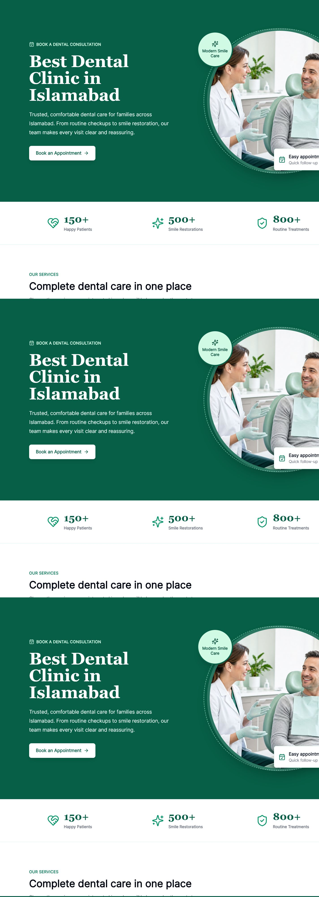
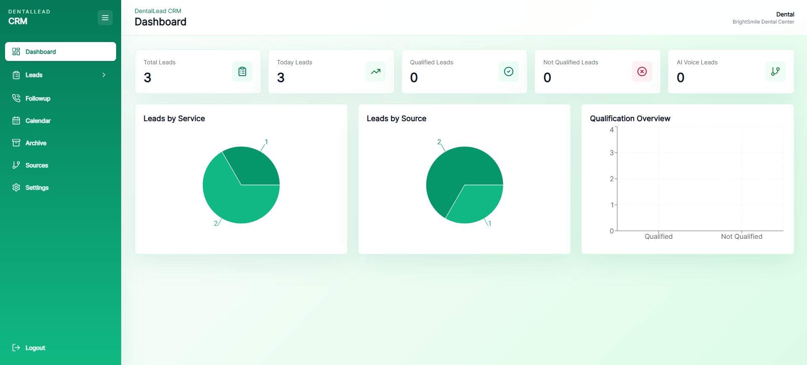
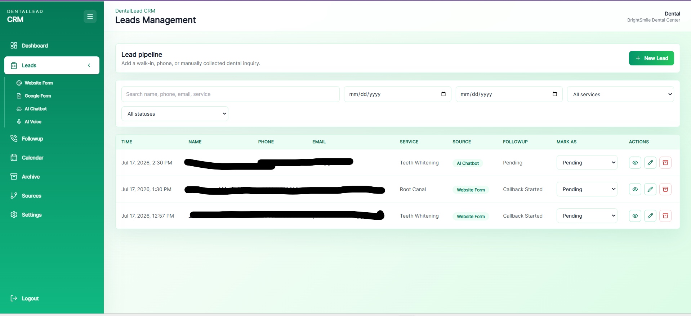
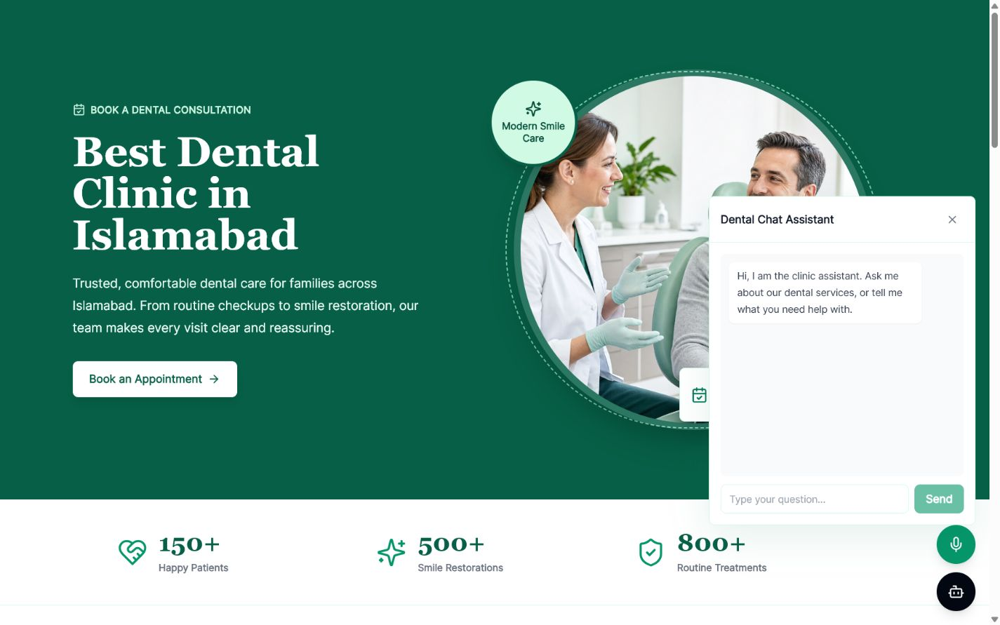
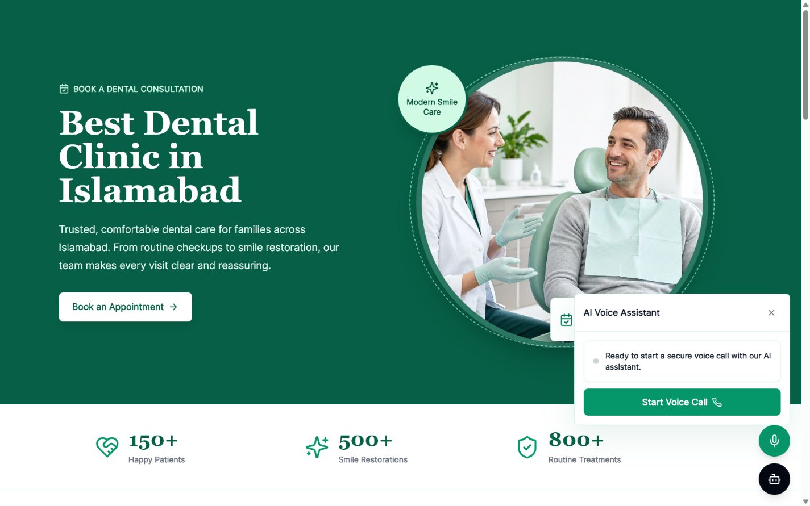
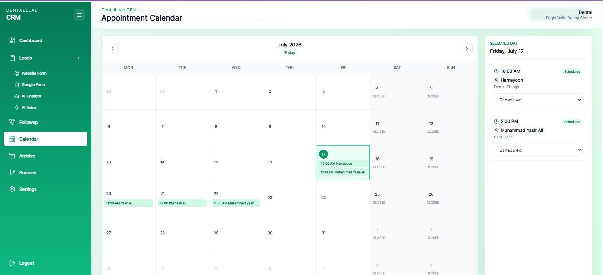
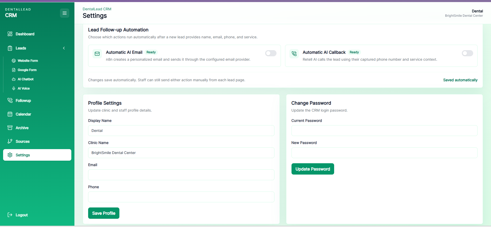
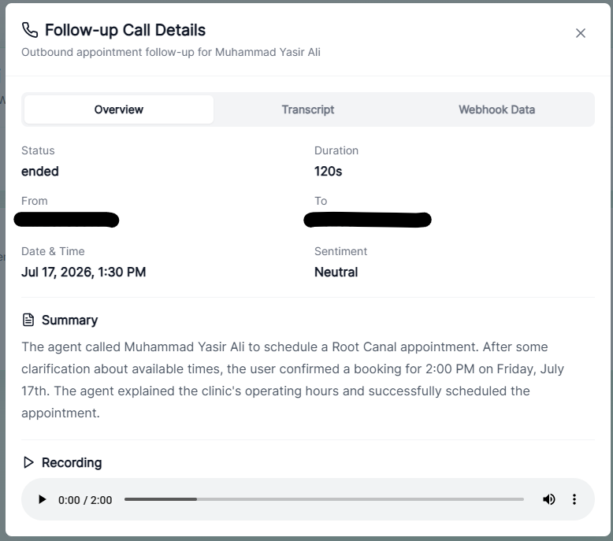
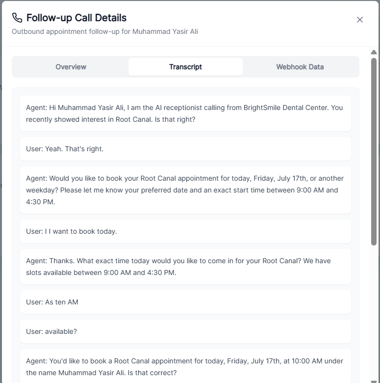
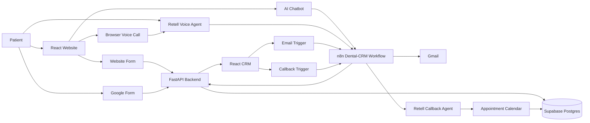

# AI-Powered Dental Lead CRM

A production-ready dental lead management system that captures inquiries from a website form, Google Forms, an AI chatbot, and a Retell AI voice agent. The CRM centralizes every lead, automates email and callback follow-ups, stores call intelligence, and books confirmed appointments on a clinic calendar.

## Live Application

- Website: [dental-crm-lovat.vercel.app](https://dental-crm-lovat.vercel.app/)
- Staff login: [dental-crm-lovat.vercel.app/stafflogin](https://dental-crm-lovat.vercel.app/stafflogin)
- Backend API: [dental-crm-neg8.onrender.com](https://dental-crm-neg8.onrender.com/)
- API documentation: [dental-crm-neg8.onrender.com/docs](https://dental-crm-neg8.onrender.com/docs)

## Product Overview

### Patient Website

The responsive public website presents clinic services, treatment examples, patient reviews, and a centered consultation form. Patients can also submit their information through the floating AI chatbot or browser-based Retell voice assistant.



### CRM Dashboard

Staff can monitor total leads, daily inquiries, qualification status, lead sources, and requested services from one dashboard.



### Lead Management

Leads are separated by source: Website Form, Google Form, AI Chatbot, and AI Voice. Staff can search, filter, update, archive, restore, or permanently delete a lead.



### AI Chatbot

The website chatbot answers general clinic questions and collects lead data sequentially: service, name, email, and phone. A lead is created only after the required information is complete.



### AI Voice Agent

Patients can start a browser voice call with the dedicated Retell lead-capture agent. The agent discusses the requested service and collects the caller's contact details before n8n saves the lead to the CRM.



### Appointment Calendar

The outbound follow-up agent can confirm an available weekday appointment between clinic hours. Confirmed bookings appear in the CRM calendar and remain linked to the existing lead.



### Follow-up Automation Settings

Automatic email and AI callback workflows can be enabled independently. Staff can still trigger either action manually from an individual lead page.



### Call Intelligence

Post-call analysis is attached to the correct existing lead. Staff can review call status, duration, summary, recording, transcript, sentiment, and raw webhook data.





## Core Features

- Responsive clinic website and consultation form
- Lead capture from Website Form, Google Form, AI Chatbot, and AI Voice
- Authenticated CRM with persistent login session
- Source-specific lead pages, search, date, service, and status filters
- Manual lead entry, editing, qualification, archive, restore, and permanent deletion
- Automatic and manual Gmail follow-up through n8n
- Automatic and manual Retell AI callbacks
- Separate inbound lead-capture and outbound appointment agents
- Appointment availability validation for Monday-Friday clinic hours
- Calendar scheduling linked to existing leads
- Voice recording, transcript, summary, sentiment, and webhook inspection
- Chat transcript storage per lead
- Dashboard analytics and source/service charts
- Supabase Postgres persistence

## System Architecture



## n8n Automation

All automation branches live inside the existing **Dental-CRM** n8n workflow. Each branch has its own production webhook and does not interfere with the other branches.

### Website Chatbot Lead Capture

1. Receives the website message and session ID.
2. Normalizes conversation history and clinic context.
3. Sends the request to the Dental Lead Agent using the GroqCloud model.
4. Maintains sequential conversation memory.
5. Checks whether name, email, phone, and service are complete.
6. Creates a CRM lead only when all required fields are available.
7. Returns a conversational reply to the website.


### Retell Voice Call Analysis

The voice-analysis branch handles two call types:

- **Inbound lead capture:** extracts contact details and creates a new AI Voice lead when the required email is available.
- **Outbound follow-up:** saves summary, recording, transcript, sentiment, and webhook data against the existing lead without creating a duplicate.


### Email Follow-up

The email branch receives a manual or automatic request. When content is missing, the AI email agent drafts a concise non-diagnostic follow-up. Gmail sends the message, and n8n records success or failure in the CRM activity history.


### Appointment Callback

The callback branch receives an existing lead ID, name, phone, service, and execution mode. It asks the backend to initiate the dedicated Retell appointment agent. The resulting call analysis returns through the voice-analysis branch and is saved to the same lead.


## Retell AI Agents

The system uses separate agents so lead capture and appointment follow-up remain independent.

### Website Lead-Capture Agent

- Starts when a visitor clicks **Start Voice Call** on the website.
- Answers general dental-service questions.
- Collects name, email, phone, and service.
- Ends the call after confirming the captured information.
- Sends post-call analysis to n8n for CRM lead creation.

### Appointment Follow-up Agent

- Calls an existing lead using the captured phone number and service context.
- Confirms that the patient is still interested.
- Offers appointment booking from Monday to Friday during clinic hours.
- Rejects weekends and unavailable times politely.
- Confirms the selected date and time once before booking.
- Thanks the patient, states the confirmed appointment, and ends the call.
- Sends recording, transcript, summary, and booking analysis back to the CRM.

## Technology Stack

| Layer | Technology |
| --- | --- |
| Frontend | React 18, Vite, Tailwind CSS |
| UI and charts | Lucide React, Recharts |
| Backend | Python, FastAPI, Uvicorn |
| Database | Supabase Postgres |
| Automation | n8n Cloud |
| AI inference | GroqCloud OpenAI-compatible model |
| Voice AI | Retell AI |
| Telephony | Twilio |
| Email | Gmail through n8n |
| Frontend hosting | Vercel |
| Backend hosting | Render |

## Project Structure

```text
dental-crm/
|-- backend/
|   |-- app/
|   |   |-- api/routes/
|   |   |-- core/
|   |   |-- db/
|   |   |-- schemas/
|   |   `-- services/
|   |-- main.py
|   `-- requirements.txt
|-- frontend/
|   |-- public/
|   `-- src/
|       |-- components/
|       |-- layouts/
|       |-- pages/
|       `-- services/
|-- supabase/
|   |-- full-schema.sql
|   `-- migrations/
|-- docs/screenshots/
|-- .env.example
`-- README.md
```

## Local Setup

### 1. Clone the repository

```bash
git clone https://github.com/Yasir019/dental-crm.git
cd dental-crm
```

### 2. Create the Supabase schema

Create a Supabase project and execute `supabase/full-schema.sql` in the Supabase SQL Editor. Existing installations can apply the relevant files from `supabase/migrations/`.

### 3. Configure environment variables

Copy `.env.example` to `backend/.env` and provide your own credentials:

```env
SUPABASE_URL=
SUPABASE_ANON_KEY=
SUPABASE_SERVICE_ROLE_KEY=
AUTH_SECRET=
INTEGRATION_API_KEY=

AI_API_KEY=

N8N_CHATBOT_WEBHOOK_URL=
N8N_VOICE_WEBHOOK_URL=
N8N_EMAIL_WEBHOOK_URL=
N8N_CALLBACK_WEBHOOK_URL=
N8N_CHATBOT_SECRET=

TWILIO_ACCOUNT_SID=
TWILIO_AUTH_TOKEN=
TWILIO_PHONE_NUMBER=

RETELL_API_KEY=
RETELL_AGENT_ID=
RETELL_CALLBACK_AGENT_ID=
RETELL_PHONE_NUMBER=
DENTAL_CLINIC_NAME=BrightSmile Dental Center

FRONTEND_URL=http://localhost:5173
CORS_ORIGIN_REGEX=^http://(localhost|127\.0\.0\.1):[0-9]+$
```

Never expose `SUPABASE_SERVICE_ROLE_KEY`, `AUTH_SECRET`, Retell, Twilio, n8n, or integration credentials in frontend code or commits.

### 4. Run the FastAPI backend

```bash
cd backend
python -m pip install -r requirements.txt
python main.py
```

The API runs at `http://127.0.0.1:5000`, with Swagger documentation at `http://127.0.0.1:5000/docs`.

### 5. Run the React frontend

```bash
cd frontend
npm install
npm run dev
```

Open `http://localhost:5173`.

## Production Deployment

### Frontend on Vercel

- Root directory: `frontend`
- Build command: `npm run build`
- Output directory: `dist`
- Environment variable: `VITE_API_BASE_URL=https://dental-crm-neg8.onrender.com/api`

### Backend on Render

- Root directory: `backend`
- Runtime: Python
- Build command: `pip install -r requirements.txt`
- Start command: `uvicorn main:app --host 0.0.0.0 --port $PORT`
- Add all backend-only credentials from `.env.example` in the Render environment settings.

### External webhook URLs

Production Google Apps Script, n8n, and Retell webhooks must use the deployed Render URL rather than localhost or ngrok.

## Security Notes

- Backend secrets are excluded from Git through `.gitignore`.
- Supabase service-role access is backend-only.
- CRM routes require authentication.
- Integration endpoints require the private integration key.
- Public chatbot traffic is proxied through FastAPI.
- Screenshots and demo recordings should hide real patient contact information and credentials.
- Upgrade Twilio from trial mode before calling unverified customer numbers.

## Future Improvements

- Multi-tenant clinic accounts and role-based staff permissions
- Per-clinic Retell, Twilio, Gmail, and n8n configuration
- Calendar synchronization with Google Calendar or Outlook
- SMS appointment reminders and missed-call recovery
- Advanced lead scoring and conversion analytics
- Audit logs, consent tracking, and configurable retention policies
- Production observability and workflow retry dashboards

## Disclaimer

This project is a dental lead-management and appointment-coordination system. It does not provide medical diagnosis or replace professional clinical advice.
