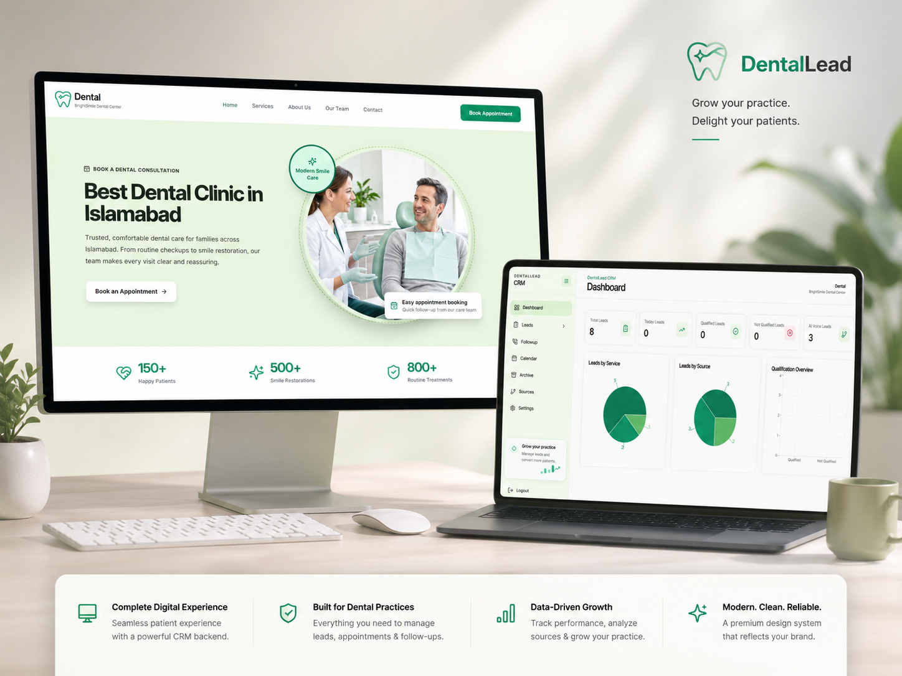
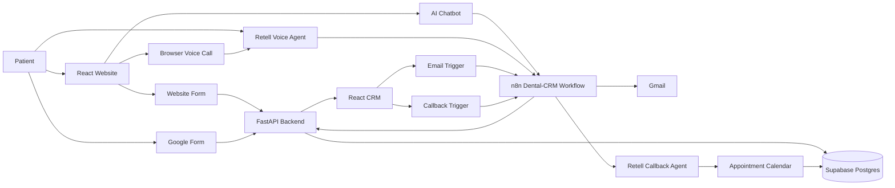
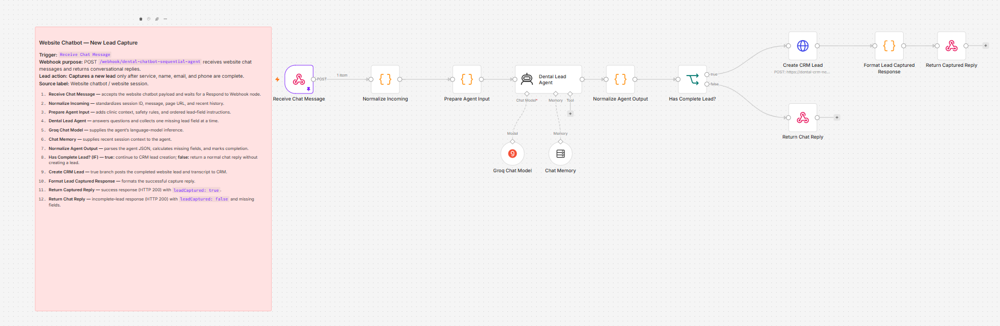
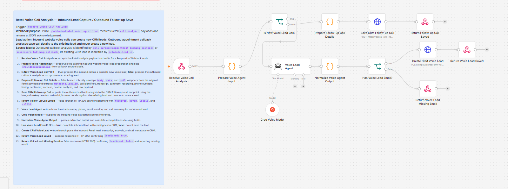
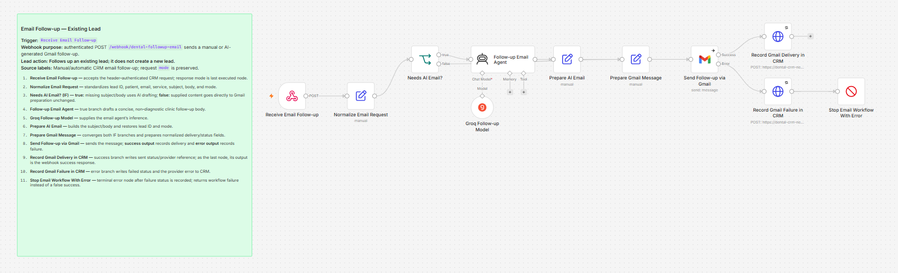
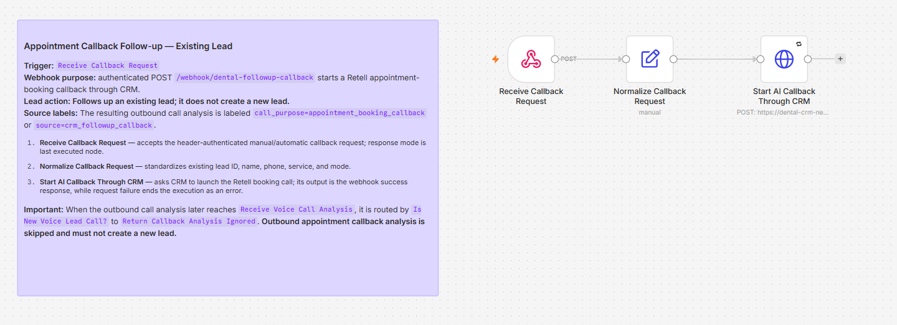

# DentalLead CRM

> An AI-powered lead capture and follow-up platform for modern dental clinics.

DentalLead CRM brings website forms, Google Forms, AI chat, and AI voice into one operational workspace. Staff can qualify leads, send personalized follow-ups, call patients with Retell AI, review call intelligence, and manage confirmed appointments from a single CRM.

## Contents

- [Project Introduction](#project-introduction)
- [Product Mockup](#product-mockup)
- [Features](#features)
- [System Flow](#system-flow)
- [Technology Stack](#technology-stack)
- [Folder Structure](#folder-structure)
- [How to Run Locally](#how-to-run-locally)
- [Production Deployment](#production-deployment)
- [Security](#security)

## Project Introduction

DentalLead CRM is a full-stack dental lead-management system designed around a simple clinic workflow:

1. A patient submits information through a website form, Google Form, AI chatbot, or AI voice assistant.
2. The backend stores the lead in Supabase and displays it in the CRM.
3. n8n orchestrates AI, email, voice, and callback automations.
4. Staff can review the lead, send follow-ups, schedule an appointment, and monitor the outcome.

The platform uses separate AI experiences for website lead capture and outbound appointment follow-up. This keeps each conversation focused and prevents appointment calls from creating duplicate leads.

## Product Mockup



## Features

### Lead Capture

- Website consultation form
- Google Form integration
- AI chatbot with sequential data collection
- Browser-based Retell AI voice lead capture
- Required contact data validation before CRM creation
- Source-specific lead views for Website Form, Google Form, AI Chatbot, and AI Voice

### CRM Operations

- Dashboard metrics for total, daily, qualified, and voice leads
- Search and filter by service, status, date, and source
- Manual lead creation and editing
- Qualification and follow-up status updates
- Lead archive, restore, and permanent deletion
- Persistent CRM authentication and profile settings
- Mobile-responsive workspace with collapsible navigation

### AI Follow-up

- Automatic or manual Gmail follow-up
- Automatic or manual Retell AI callback
- Separate inbound lead-capture and outbound appointment agents
- Appointment availability rules for Monday-Friday, 9 AM-5 PM
- Weekend and out-of-hours handling
- Confirmed appointment calendar linked to the existing lead

### Conversation Intelligence

- AI and user conversation transcript
- Voice call recording playback
- Call summary, sentiment, status, and duration
- Raw Retell webhook inspection
- Chat transcript storage per session and lead
- Contact details highlighted in chatbot and voice conversations

## System Flow



## n8n Automation

All automations belong to the **Dental-CRM** workflow in n8n. The workflow contains separate branches for each responsibility:

| Branch | Responsibility |
| --- | --- |
| Chatbot lead capture | Answers dental questions and captures complete leads sequentially |
| Retell voice analysis | Saves inbound voice leads and outbound call intelligence |
| Email follow-up | Generates and sends Gmail follow-up messages |
| Appointment callback | Starts the Retell appointment agent for an existing lead |

### Chatbot Lead Capture

The chatbot receives a session message, keeps conversation context, uses the GroqCloud model through the AI Agent node, and asks for missing fields one at a time. The lead is sent to the CRM only after the required name, email, phone, and service data is complete.



### Voice Analysis and Lead Save

Retell sends post-call analysis to n8n. Inbound calls can create a new lead when the required email is available. Outbound follow-up calls update the original lead with call data and never create a duplicate appointment lead.



### Email Follow-up

The email branch accepts automatic and manual requests, prepares a concise clinic follow-up message, sends it through the connected Gmail credential, and records delivery or failure in the CRM.



### Appointment Callback

The callback branch receives an existing lead ID, starts the outbound Retell appointment agent, and routes the resulting analysis back to the original lead and appointment calendar.



## Technology Stack

<p>
  <a href="https://react.dev/"></a>&nbsp;
  <a href="https://vitejs.dev/"></a>&nbsp;
  <a href="https://tailwindcss.com/"></a>&nbsp;
  <a href="https://fastapi.tiangolo.com/"></a>&nbsp;
  <a href="https://supabase.com/"></a>&nbsp;
  <a href="https://n8n.io/"></a>&nbsp;
  <a href="https://www.twilio.com/"></a>&nbsp;
  <a href="https://vercel.com/"></a>&nbsp;
  <a href="https://render.com/"></a>
</p>

| Layer | Technology | Role |
| --- | --- | --- |
| Frontend | React, Vite, Tailwind CSS | Public clinic website and authenticated CRM |
| UI | Lucide React, Recharts | Icons, charts, and responsive interface |
| Backend | Python, FastAPI, Uvicorn | API, auth, lead operations, integrations |
| Database | Supabase Postgres | Leads, conversations, calls, appointments, settings |
| AI automation | n8n Cloud, GroqCloud | Workflow orchestration and AI agent inference |
| Voice | Retell AI, Twilio | Browser voice, outbound calls, recording, analysis |
| Email | Gmail through n8n | Manual and automatic follow-up messages |
| Hosting | Vercel, Render | Frontend and backend deployment |

## Folder Structure

```text
dental-crm/
├── backend/
│   ├── app/
│   │   ├── ai/                 # AI-related backend helpers
│   │   ├── api/routes/         # FastAPI route modules
│   │   ├── core/               # Configuration and shared settings
│   │   ├── db/                 # Database clients and persistence helpers
│   │   ├── schemas/            # Pydantic request and response schemas
│   │   ├── services/           # Lead, auth, voice, chatbot, and follow-up logic
│   │   └── utils/              # Shared backend utilities
│   ├── main.py                 # FastAPI application entry point
│   └── requirements.txt        # Python dependencies
├── frontend/
│   ├── public/images/          # Website treatment and hero media
│   └── src/
│       ├── components/         # Reusable UI and conversation components
│       ├── layouts/             # CRM shell and navigation layouts
│       ├── pages/               # Public, auth, CRM, calendar, and settings pages
│       ├── services/            # API and integration clients
│       ├── styles/              # Global styles and Tailwind entry points
│       └── utils/               # Constants and frontend helpers
├── supabase/
│   ├── full-schema.sql         # Complete database schema
│   └── migrations/             # Incremental SQL migrations
├── docs/screenshots/           # n8n workflow visuals used in this README
├── .env.example                # Environment variable template
├── Requirement.md               # Product requirements and planned scope
└── README.md
```

## How to Run Locally

### Prerequisites

- Python 3.11+
- Node.js 18+
- npm
- A Supabase project
- Optional for full integrations: n8n, GroqCloud, Retell, Twilio, and Gmail credentials

### 1. Clone and install

```bash
git clone https://github.com/Yasir019/dental-crm.git
cd dental-crm
npm run install:all
```

### 2. Configure the backend

Copy `.env.example` to `backend/.env` and provide your own values. Never commit `backend/.env`.

```env
SUPABASE_URL=
SUPABASE_ANON_KEY=
SUPABASE_SERVICE_ROLE_KEY=
AUTH_SECRET=
INTEGRATION_API_KEY=

AI_API_KEY=

N8N_CHATBOT_WEBHOOK_URL=
N8N_VOICE_WEBHOOK_URL=
N8N_FOLLOWUP_WEBHOOK_URL=
N8N_EMAIL_WEBHOOK_URL=
N8N_CALLBACK_WEBHOOK_URL=
N8N_CHATBOT_SECRET=

TWILIO_ACCOUNT_SID=
TWILIO_AUTH_TOKEN=
TWILIO_PHONE_NUMBER=

RETELL_API_KEY=
RETELL_AGENT_ID=
RETELL_CALLBACK_AGENT_ID=
RETELL_PHONE_NUMBER=
DENTAL_CLINIC_NAME=BrightSmile Dental Center

FRONTEND_URL=http://localhost:5173
CORS_ORIGIN_REGEX=^http://(localhost|127\.0\.0\.1):[0-9]+$
```

### 3. Create the database

Run `supabase/full-schema.sql` in the Supabase SQL Editor. The migration files in `supabase/migrations/` contain incremental changes for existing installations.

### 4. Start both applications

From the repository root:

```bash
npm run dev
```

The services will be available at:

- Website and CRM: `http://localhost:5173`
- FastAPI: `http://127.0.0.1:5000`
- Swagger API docs: `http://127.0.0.1:5000/docs`

To run them separately:

```bash
# Backend
cd backend
python -m uvicorn main:app --host 127.0.0.1 --port 5000 --reload

# Frontend, in a second terminal
cd frontend
npm run dev
```

## Production Deployment

### Vercel

- Import the GitHub repository.
- Set the root directory to `frontend`.
- Build command: `npm run build`.
- Output directory: `dist`.
- Add `VITE_API_BASE_URL=https://<your-render-service>/api`.

### Render

- Create a Python web service from the same repository.
- Set the root directory to `backend`.
- Build command: `pip install -r requirements.txt`.
- Start command: `uvicorn main:app --host 0.0.0.0 --port $PORT`.
- Add the backend variables from `.env.example` in Render Environment settings.

### Integrations

Production n8n, Google Apps Script, and Retell callbacks must point to the deployed Render API URL. Do not use localhost or ngrok URLs in production.

## Security

- Keep Supabase service-role, auth, Twilio, Retell, n8n, and AI credentials server-side.
- Never place secrets in frontend source code or commit them to Git.
- Protect CRM routes with authentication.
- Protect integration endpoints with a private integration key.
- Redact patient contact details from public demos and screenshots.
- Upgrade Twilio from trial mode before calling unverified numbers.

## License and Disclaimer

This project is a private dental lead-management system. It supports administrative lead capture and appointment coordination; it does not provide medical diagnosis or replace professional clinical advice.
